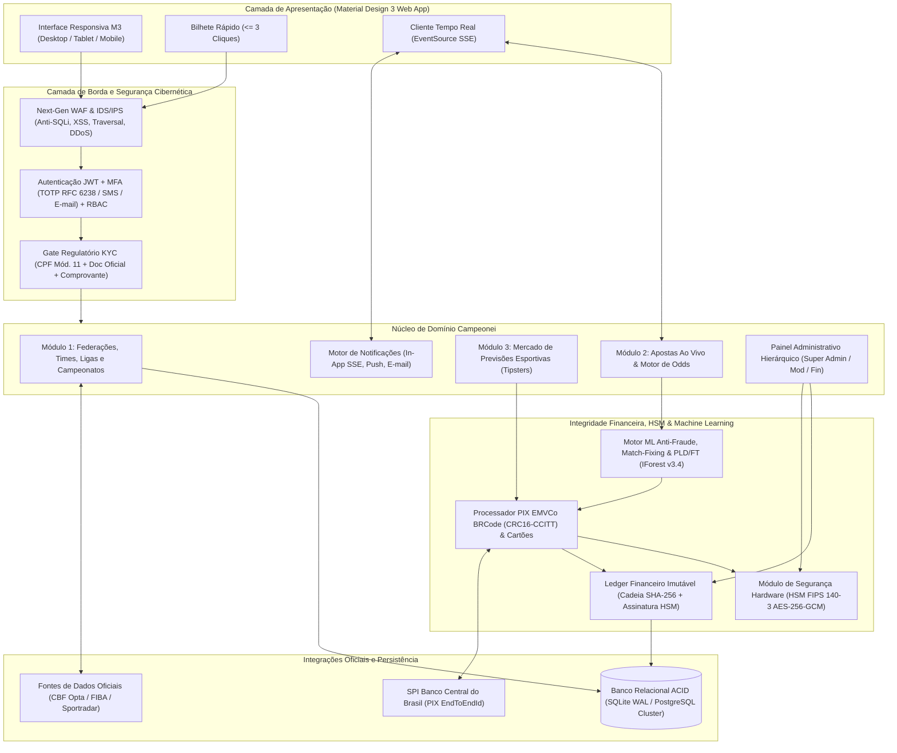
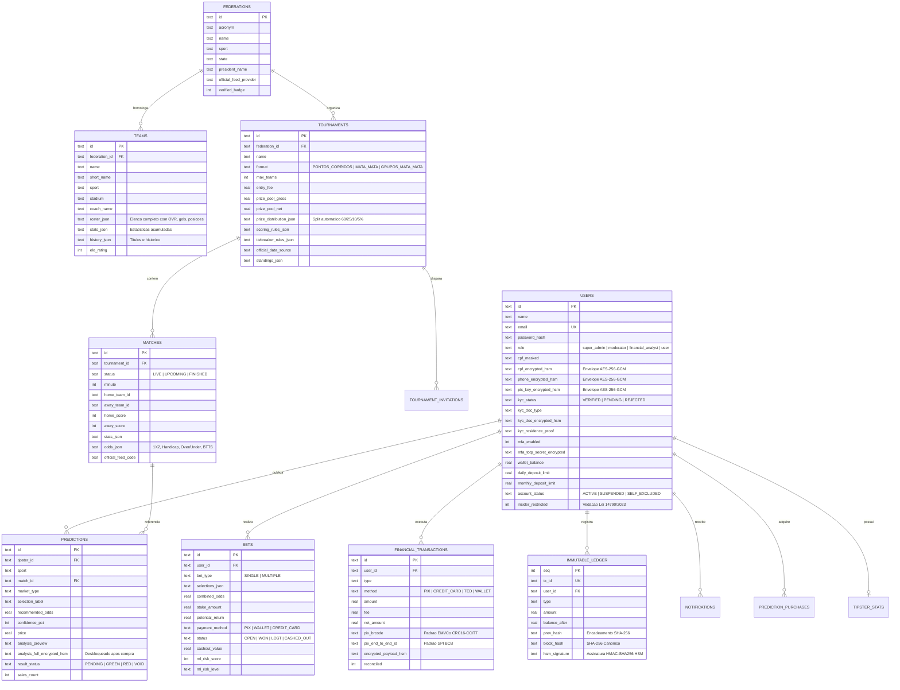

# Arquitetura do Sistema e Diagramas de Banco de Dados — Campeonei (`campeonei.com.br`)

## 1. Visão Geral da Arquitetura

A plataforma **Campeonei (`campeonei.com.br`)** foi projetada sob uma arquitetura orientada a eventos de baixa latência, segurança financeira de nível bancário e interface responsiva baseada no **Material Design 3 (M3)** — o sistema de design open source mais recente do Google.

---

## 2. Diagrama Entidade-Relacionamento do Banco de Dados (ER Diagram)

O modelo relacional garante integridade referencial estrita (`FOREIGN KEYS`), transações atômicas (`BEGIN IMMEDIATE ... COMMIT`) e trilha de auditoria imutável para 100% das operações financeiras.

---

## 3. Arquitetura de Criptografia HSM (Envelope Encryption) e Ledger Imutável

1. **Hierarquia de Chaves (KEK $\rightarrow$ DEK)**:
   - A chave mestra (`Master KEK`) permanece isolada na partição criptográfica do módulo HSM ([`src/security/hsmCrypto.js`](file:///home/antigravity/fortunatolf-tech/campeonei/src/security/hsmCrypto.js)).
   - As chaves de criptografia de dados (`DEK` de 256 bits) são geradas aleatoriamente via CSPRNG, envelopadas pela `KEK` com **AES-256-GCM** e identificadas por `kid` (`hsm-dek-2026-v1`).
   - Cada dado sensível (CPF, chave PIX, documento RG/CNH, payload de pagamento e análise VIP de prognosticadores) é criptografado com um vetor de inicialização único de 96 bits (`iv`), tag de autenticação de 128 bits (`tag`) e vínculo de contexto (`AAD` — *Additional Authenticated Data*).
2. **Ledger Financeiro Imutável Encadeado por Hash (`immutable_ledger`)**:
   - Cada transação gera um bloco contendo `prev_hash` (hash SHA-256 do bloco anterior), dados canônicos da transação e assinatura `HMAC-SHA256` emitida pelo HSM.
   - A função [`verifyFullLedgerIntegrity`](file:///home/antigravity/fortunatolf-tech/campeonei/src/db/database.js) percorre 100% da cadeia verificando cada elo criptográfico e assinatura antes da reconciliação bancária.
